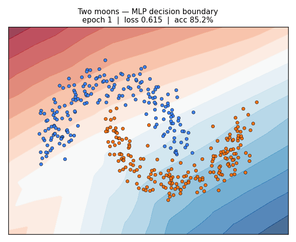
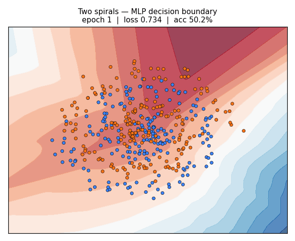

# Neural Network from Scratch (NumPy only)

[](https://github.com/YOUR_USERNAME/neural-network-from-scratch/actions/workflows/ci.yml)

<p align="center">
  
  
</p>

A complete neural-network library — forward pass, backpropagation, and gradient-descent
optimisers — implemented from first principles in NumPy. No PyTorch, no TensorFlow, no
autograd. Every gradient is derived by hand and **verified numerically against finite
differences**, then the library is used to train an MLP to **97.7% accuracy on MNIST**
in under a minute on a laptop CPU.

## Results

| Experiment | Result |
|---|---|
| MNIST (784-128-64-10 MLP, Adam, 8 epochs) | **97.74% test accuracy**, 109,386 params, 48s CPU |
| Gradient check (analytic vs. finite differences) | max abs error **7.7e-12** across all weights/biases |
| Two-spiral decision boundary | solved by a 2×32 ReLU MLP (impossible for any linear model) |
| Test suite | 30 tests, including numerical gradient checking of every layer and loss |

Reproduce with:

```bash
pip install -r requirements.txt
python -m unittest discover -s tests      # 30 tests, ~0.3s
python scripts/train_mnist.py             # downloads MNIST once, then trains
python scripts/toy_visualization.py       # regenerates the GIFs above
python scripts/gradient_check_demo.py     # prints the gradient-error table
```

## What's implemented

**Layers** — `Dense` (He/Kaiming initialisation: `W ~ N(0, √(2/fan_in))`), inverted
`Dropout` (scales at train time, identity at eval), `Flatten`.

**Activations** — ReLU, LeakyReLU, Sigmoid, Tanh, each with its hand-derived backward
pass (e.g. sigmoid: `f'(x) = f(x)(1 − f(x))`).

**Losses**
- `SoftmaxCrossEntropy` — softmax and cross-entropy *fused* into one op. The max-shift
  trick (`logits − max`) prevents `exp` overflow, and the fused backward collapses to
  the classic identity `(softmax(y) − one_hot(t)) / batch` with no `log(0)` anywhere.
- `BinaryCrossEntropy` — stable form via `logaddexp(0, ±z)`; backward is `sigmoid(z) − t`.
- `MSELoss`.

**Optimisers** — SGD, SGD + classical momentum (`v ← μv + g`), and Adam with
bias-corrected first/second moment estimates.

**The backprop contract** — every layer guarantees `backward(dL/dy) → dL/dx` and exposes
matched `params()` / `grads()` dictionaries. `Sequential.backward` is the entire
algorithm — reverse-order chain rule, no computation graph, no tracing:

```
forward:  x₀ → layer₁.forward → … → layerₙ.forward → y
backward: dL/dy → layerₙ.backward → … → layer₁.backward → dL/dx₀
```

## Why gradient checking matters

The tests compare every analytic gradient against a brute-force central finite
difference, `dL/dθᵢ ≈ [L(θ+ε) − L(θ−ε)] / 2ε`, and assert agreement to ~1e-5 or better
(observed: ~1e-11). This is what upgrades the claim from "backprop runs" to
"backprop is *correct*".

It paid off immediately during development: an early optimiser design cached references
to each layer's gradient arrays at construction — but layers *rebind* their gradient
attributes on every backward pass (`self.dW = ...`), so the optimiser silently read
stale zeros and nothing trained. The end-to-end "gradient descent must reduce loss"
test caught it, and the optimisers now re-resolve `(param, grad)` pairs each step.
That story — numerical verification catching a silent aliasing bug — is exactly why
this technique exists.

## Project structure

```
nn/
  activations.py   ReLU, LeakyReLU, Sigmoid, Tanh (+ backward passes)
  layers.py        Dense (He init), Dropout (inverted), Flatten
  losses.py        SoftmaxCrossEntropy (fused), BinaryCrossEntropy, MSE
  optimizers.py    SGD, SGDMomentum, Adam
  model.py         Sequential: forward/backward/train_on_batch/fit
  data.py          MNIST loader (cached), moons/spirals generators, batching
tests/
  test_gradients.py   numerical gradient checking + end-to-end descent test
  test_nn.py          layers, losses, optimisers, data utilities
scripts/
  gradient_check_demo.py   analytic vs. finite-difference error table
  toy_visualization.py     animated decision-boundary GIFs + loss curves
  train_mnist.py           MNIST training + loss curve + confusion matrix
outputs/                   generated figures (gitignored)
```

## Résumé bullets (ready to paste)

- Implemented a neural-network library in pure NumPy — hand-derived backpropagation for
  dense layers, fused softmax cross-entropy, dropout, and SGD/momentum/Adam optimisers —
  verified to 1e-11 accuracy against numerical gradient checking.
- Trained an MLP to 97.7% test accuracy on MNIST in 48s on CPU, with reproducible
  training-dynamics and confusion-matrix reporting.
- Built animated decision-boundary visualisations demonstrating hidden layers learning
  non-linearly separable problems (two-moons, two-spirals).

## Ideas for v2

- Conv2d + pooling layers (same `params()/grads()` contract, im2col)
- A miniature reverse-mode autograd engine (tape-based) and a comparison of the two designs
- Learning-rate schedules (cosine decay, warmup) and weight decay (AdamW)
- Batch/Layer normalisation, and a study of why they help
- Mixed-precision experiments (float32 vs float64 training stability)
- Train a digit recognizer served as a tiny CLI: `python -m nn.demo draw.gif`

## Requirements

Python 3.10+ with NumPy, matplotlib, Pillow (see `requirements.txt`). MNIST (~11 MB) is
downloaded once to `data/` and cached.
